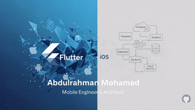

  

  

  
  

  
  
  
  

---

## 👨‍💻 About Me

Results-oriented Lead Mobile Engineer with **10+ years** architecting and shipping production-grade mobile apps. I care deeply about systems that are **scalable, maintainable, and a joy to work in** — and I share what I learn through open-source packages and technical writing.

- 🏛️ Creator of the **[MVN (Model-View-Notifier) Architecture](https://abdelrahman-abied.github.io/mvn-architecture-pattern/)** for Flutter + Riverpod
- 📦 Author of **3 published Flutter packages** on pub.dev
- ✍️ Writing about Mobile Architecture, Clean Code, and Flutter on **[Medium](https://medium.com/@abied.abiad)**
- 💬 Ask me about: **Flutter architecture, state management, KMP, mobile system design**

---

## 🧭 What I Do

- 📐 **Solution design:** turn business requests into build-ready specs, with user stories, acceptance criteria, API contracts, behaviour states and QA plans
- 🔍 **Design & API review:** catch breaking changes, performance risks and missing requirements before development starts
- 👥 **Technical leadership:** lead delivery teams, set engineering standards, and mentor engineers through ADRs, POCs and code reviews

---

## 🎯 Currently

- 🔨 Building **showcase_tutorial v2** with multi-widget targeting
- 📚 Deep-diving into **KMP + Compose Multiplatform** for shared mobile architecture
- ✍️ Writing a series on **Domain-Driven Design for Mobile**
- 🤝 Open to consulting on **Flutter architecture audits** and **team mentoring**

---

## 🌟 Featured Projects

<table>
  <tr>
    <td width="50%" valign="top">
      <h3>🤖 <a href="https://github.com/abdelrahman-abied/flutter-pro-skills">flutter-pro-skills</a></h3>
      
21 Agent Skills that detect a Flutter app's architecture, then write and review its code by that pattern's own rules.

      

        
        
        
      

    </td>
    <td width="50%" valign="top">
      <h3>🔎 <a href="https://github.com/abdelrahman-abied/flutter-intercept">Flutter Intercept</a></h3>
      
Inspect, pause, edit, block and mock a Flutter app's HTTP traffic inside VS Code, Cursor or Android Studio, with no app code to change and no certificate to install.

      

        
        
        
      

    </td>
  </tr>
  <tr>
    <td width="50%" valign="top">
      <h3>🎯 <a href="https://github.com/abdelrahman-abied/showcase_tutorial">showcase_tutorial</a></h3>
      
A Flutter package to highlight widgets step-by-step for elegant onboarding and feature discovery.

      

        
        
        
      

    </td>
    <td width="50%" valign="top">
      <h3>🏛️ <a href="https://abdelrahman-abied.github.io/mvn-architecture-pattern/">MVN Architecture</a></h3>
      
A clean, scalable architecture pattern for Flutter apps using Riverpod — built around the Model-View-Notifier philosophy.

      

        
        
        
      

    </td>
  </tr>
  <tr>
    <td width="50%" valign="top">
      <h3>🖼️ <a href="https://github.com/abdelrahman-abied/photo_gallery_plus">photo_gallery_plus</a></h3>
      
A modern, customizable photo gallery widget for Flutter with advanced viewing features.

      

        
        
        
      

    </td>
    <td width="50%" valign="top">
      <h3>📸 <a href="https://github.com/abdelrahman-abied/gallery_picker_plus">gallery_picker_plus</a></h3>
      
A flexible media picker for Flutter apps — handles images, videos, and multi-selection elegantly.

      

        
        
        
      

    </td>
  </tr>
</table>

---

## 🧰 Developer Tools

| Tool | Type | Description |
| :--- | :--- | :--- |
| **[flutter-pro-skills](https://github.com/abdelrahman-abied/flutter-pro-skills)** | Agent Skills · [npm](https://www.npmjs.com/package/flutter-pro-skills) | Architecture-aware writing and review for Dart & Flutter. Install with `npx flutter-pro-skills` |
| **[flutter-security-audit](https://github.com/abdelrahman-abied/flutter-security-audit)** | Agent Skill | Audits Flutter apps for security and privacy gaps, with a fix and an attack-based check for every finding |
| **[Flutter Intercept](https://github.com/abdelrahman-abied/flutter-intercept)** | VS Code · Cursor · Android Studio | Inspect and mock a Flutter app's HTTP traffic |
| **[Clean Architecture and MVN with Riverpod](https://github.com/abdelrahman-abied/vs-ext-clean-architecture-mvn-with-riverpod)** | VS Code · Cursor · Antigravity | Generates feature folders and starter files for MVN projects |

---

## 📦 Open-Source Packages

| Package | Version | Description |
| :--- | :--- | :--- |
| **[showcase_tutorial](https://pub.dev/packages/showcase_tutorial)** |  | Highlight widgets step-by-step for elegant onboarding & feature discovery |
| **[photo_gallery_plus](https://pub.dev/packages/photo_gallery_plus)** |  | Modern photo gallery widget with advanced features |
| **[gallery_picker_plus](https://pub.dev/packages/gallery_picker_plus)** |  | Flexible media picker for Flutter apps |

---

## 🏛️ Architectural Philosophy

> Build apps that aren't just functional — but **robust, testable, and a pleasure to maintain**.

- **Separation of Concerns** — decoupled components that are easy to test, debug, and replace
- **Scalability First** — designing systems that grow without demanding a rewrite
- **Developer Experience** — clean, well-documented code that empowers contributors
- **Pragmatism Over Dogma** — the right tool for the job, not blind loyalty to a methodology

### 🚀 MVN Architecture

I created **MVN (Model–View–Notifier)** — a clean, scalable pattern purpose-built for Flutter apps using Riverpod. It separates business logic from UI, simplifies state, and keeps codebases easy to reason about at scale.

📖 **[Read the full MVN reference →](https://abdelrahman-abied.github.io/mvn-architecture-pattern/)**

---

## 🛠️ Tech Stack

  

**Architecture**
`MVN` · `Clean Architecture` · `MVVM` · `MVI` · `MVP` · `VIPER` · `Server-Driven UI / BFF`

**State Management**
`Riverpod` · `BLoC` · `Cubit` · `Provider` · `GetX` · `ViewModel`

**Integration**
`REST APIs` · `Payment Gateways` · `Bluetooth Low Energy` · `Access-Control Systems`

**Security & Performance**
`Certificate Pinning` · `Payload Encryption` · `App Hardening` · `Caching` · `Backward Compatibility`

---

## 🌍 Domains

`Telecom` · `Fintech & Payments` · `Government` · `Access Control` · `Workforce Management` · `Logistics` · `E-commerce`

---

## ✍️ Latest Articles

<!-- BLOG-POST-LIST:START -->
- [Flutter Edge AI Part 1: What Edge AI Is and How to Run AI Models Offline](https://medium.com/@abied.abiad/flutter-edge-ai-part-1-what-edge-ai-is-and-how-to-run-ai-models-offline-d9d484751795?source=rss-bbc5a68595bd------2)
- [What Is Legacy Code: The Definition Everyone Quotes Was Written for a World That No Longer Exists](https://medium.com/@abied.abiad/what-is-legacy-code-the-definition-everyone-quotes-was-written-for-a-world-that-no-longer-exists-7ef5738841c1?source=rss-bbc5a68595bd------2)
- [Does Mobile Architecture Still Matter in the Age of AI?](https://medium.com/@abied.abiad/does-mobile-architecture-still-matter-in-the-age-of-ai-d6c0fdcb0372?source=rss-bbc5a68595bd------2)
- [How to Write a Mobile Technical Design Doc: It Is a Decision Record, Not Documentation](https://medium.com/@abied.abiad/how-to-write-a-mobile-technical-design-doc-it-is-a-decision-record-not-documentation-390791b4cfd9?source=rss-bbc5a68595bd------2)
- [How to Slice User Stories for Mobile Teams: The Vertical Slice Is a Backend Idea](https://medium.com/@abied.abiad/how-to-slice-user-stories-for-mobile-teams-the-vertical-slice-is-a-backend-idea-4321e43741db?source=rss-bbc5a68595bd------2)
<!-- BLOG-POST-LIST:END -->

➡️ **[Read more on Medium](https://medium.com/@abied.abiad)**

---

## 📊 GitHub Stats

  

  

## 🏆 Highlights

  
  
  

  
  

  
  
  

---

  

---

## 🤝 Let's Build Something Together

<table align="center">
  <tr>
    <td align="center" width="33%">
      <h3>💼 Hire Me</h3>
      
Open to new opportunities, consulting, architecture audits, and team mentoring

      
    </td>
    <td align="center" width="33%">
      <h3>📦 Use My Packages</h3>
      
Three battle-tested Flutter packages on pub.dev

      
    </td>
    <td align="center" width="33%">
      <h3>📖 Read My Work</h3>
      
Architecture, Clean Code, and Flutter deep-dives

      
    </td>
  </tr>
</table>

  <i>💡 "The best architecture is the one your team can maintain at 2 AM."</i>

  <i>⭐ From <a href="https://github.com/abdelrahman-abied">abdelrahman-abied</a> — feel free to connect, collaborate, or just say hi!</i>

